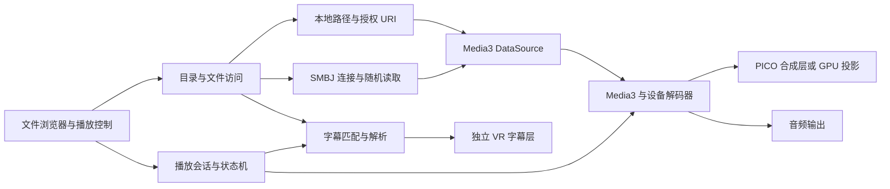

# L's VRPlayer 开发计划

制定日期：2026-09-06。本文保留最初的开发与验收范围；后续已实施 Player 场景、原生播放内核、GPU 投影、文件浏览、SMB、字幕与 VR UI，并构建安装到 PICO 4。当前交付和验证进展以 `BuildAndUse.zh-CN.md`、`Validation` 目录及验证报告为准，不能将计划中的所有兼容组合视为已经验收。

用户已确定：新增组件只使用免费或开源方案；首版在自己的 PICO 4 上通过 APK 安装使用。沿用现有 Unity 和 PICO SDK，不引入付费视频插件。这里的“免费或开源”不表示现有 Unity、PICO SDK 全部属于开源软件。

## 1. 已检查的项目基础

| 项目 | 实际状态 | 对开发的影响 |
| --- | --- | --- |
| Unity | 6000.3.23f1 | 保持版本，先完成真机基线，避免同时升级引擎 |
| PICO Integration | 3.4.0；锁定文件解析到 `c93a59bab88d337fe0d54140499712897cedbe52` | manifest 使用未指定版本的 Git URL，M0 将其固定到已验证提交 |
| XR Interaction Toolkit | 3.3.2，已导入 Starter Assets 与设备模拟器 | 复用射线交互和输入框架 |
| 输入与 UI | Input System 1.20.0、uGUI 2.0.0 | 使用世界空间 uGUI 与 TextMeshPro，准备中文字体 |
| 渲染 | Built-in 管线、Linear 色彩空间；PICO 当前配置为 MultiPass | 不因播放器需求迁移 URP；核查视频色彩转换，再对比 Multiview |
| Android | ARM64、IL2CPP、minSdk 29、targetSdk 自动；图形 API 自动选择 | M0 固定已验证的 SDK 与图形 API，形成可重复构建 |
| 应用标识 | `com.linxyi.LsVRPlayer` | 延用，发布版本递增 versionCode |
| 编辑器场景 | `Assets/Scenes/SampleScene.unity`，处于 Edit Mode、未编译、工具就绪 | XR Origin 已包含 PXR_Manager；场景中额外根相机已禁用，不应误判为双相机冲突 |
| 构建入口 | XRI Starter Assets 的 `DemoScene.unity` | 正式播放器场景建立后，需要明确切换 Build Settings |
| UnityMCP | 已成功读取编辑器状态、项目资料、场景根对象和控制台 | 当前控制台查询返回 0 条 error/warning；不等于 Android 构建已经通过 |
| 连接设备 | ADB 已授权；型号 A8110；Android 10/API 29；系统版本 5.13.7；arm64-v8a | 首轮权限和兼容性验证以这台设备为准 |
| Git | 已有多项用户修改和未跟踪资源 | 后续开发保留这些修改，只整理本次新增内容 |

本地 SDK 源码中已确认存在 `PXR_CompositionLayer`、Android 外部 Surface、左右/上下立体排列及多种合成层形状。旧 `PXR_OverLay` 已标记弃用，应使用新类。接口存在不代表每种形状在当前 PICO 4 固件上都能正常使用，必须通过 M1、M3 的设备验证。

## 2. 首版完成范围

验收的是“来源 × 容器 × 视频编码 × 音频编码 × 投影 × 立体排列”的组合。不能仅凭 `.mp4`、`.mkv` 或文件名写了“8K”就承诺能够播放。Android 播放内核对容器的支持与设备解码器的能力是不同层次。[Media3 格式说明](https://developer.android.com/media/media3/exoplayer/supported-formats)

### 2.1 视频与 VR 格式

| 维度 | 核心可用版必须实现 | 完整首版兼容性工作 | 明确边界 |
| --- | --- | --- | --- |
| 普通视频 | 2D 平面屏幕，正确宽高比、旋转、黑边 | 平面/曲面屏幕切换，适应/填充/原始比例 | 屏幕弯曲是观看方式，与源视频投影分开设置 |
| 立体排列 | Mono、左右 SBS/LR、上下 OU/TB；Half/Full；左右眼交换 | 记忆每部影片设置，单眼作为 2D 观看 | SBS/OU 不自动表示 VR180/360；Half/Full 需补偿显示比例 |
| 沉浸式投影 | 等距柱状 Equirectangular 180°/360°，各自支持 Mono/SBS/OU | Cubemap、EAC 的明确布局预设；常见鱼眼与双鱼眼的参数化映射 | 明确面顺序、朝向、镜头角度和有效区域；不能只提供一个泛化“鱼眼”开关 |
| 容器 | MP4、MKV 为主测试集 | WebM、MOV、M4V、TS 按实际内核与样片逐项公布结果 | MOV/TS 的具体流、索引与音轨差异需要单独验证；不承诺全部 AVI/WMV/ISO |
| 视频编码 | H.264/AVC、H.265/HEVC，以硬件解码为主 | VP9、HEVC Main10 按设备能力实测 | AV1、MVC 蓝光 3D、MV-HEVC 空间视频不作为首版必达项 |
| 分辨率/帧率 | 1080p30/60、4K30/60 为分层测试目标 | 5.7K/6K/8K、不同码率及 profile/level 探测 | 4K60、8K、10-bit 均需实测，不将 SDK 接口或芯片宣传当验收结果 |
| 音频 | AAC/MP3、系统支持音轨；音量、静音、音轨选择 | 补齐 AC-3/E-AC-3/DTS 等电影常见音轨的开源软件解码及双声道输出 | 视频有画面但音轨不能播放不能算兼容；Atmos/DTS:X 对象音效不作为首版承诺 |
| 色彩 | SDR BT.709 基线；无错误 gamma、黑位或明显偏色 | 验证 HDR10/HLG 到 SDR 的映射路线 | Main10 可解码不等于 HDR 正确；Dolby Vision、HDR 原样输出不作为首版必达项 |

自动识别优先级：用户保存的覆盖设置 → 可靠元数据 → 带词边界的文件名提示 → 默认 2D。支持 `SBS/LR/HSBS/FSBS/OU/TB/HOU/180/360` 等提示，存在冲突时展示建议并让用户手动切换。仅凭宽高比不强制推断投影。

普通等距柱状 180° 与包含网格/镜头元数据的 VR180 相机文件需要区分；后者单列兼容用例，不能把一张半球网格当成完整 VR180 规范实现。[Google 空间视频规范](https://github.com/google/spatial-media/blob/master/docs/spherical-video-rfc.md)、[VR180 规范](https://github.com/google/spatial-media/blob/master/docs/vr180.md)

### 2.2 文件浏览与来源

- 本地：授权目录、上级目录、面包屑、刷新、名称/日期/大小排序、视频筛选、当前目录搜索、最近打开、目录收藏。
- SMB：手动填写主机/IP、端口、共享名、可选域、用户名和密码；支持匿名共享与账户共享；保存多个服务器与收藏路径。
- 浏览体验：异步分页或虚拟列表，取消过时请求；长文件名、中文、空格、空目录、大目录都有明确展示。
- 播放体验：边读边播、文件中部及末尾跳转、缓冲提示、取消加载、断网重试和可返回文件列表的错误页。
- 首版文件管理器以浏览和打开为核心；文件删除、移动、批量重命名、自动扫描整个网段属于后续扩展。

### 2.3 字幕与播放器功能

- 在本地和 SMB 视频的同一目录发现、列出并选择同名 SRT，包括语言标识后缀；可关闭字幕，也可手动浏览选择其他 SRT。
- 中文字幕与双语多行，字幕大小、颜色、描边/背景、垂直位置、舒适距离、时间偏移可调。
- 播放/暂停、停止、进度拖动、快进/快退、音量/静音、音轨切换、倍速、单曲循环、目录顺序播放、上一部/下一部。
- 断点续播、最近播放、每部影片的投影/眼序/字幕/音轨设置记忆；支持清空记录。
- VR 必需：一键重新定向、坐姿/躺卧观看、屏幕距离/大小/高度/曲率、控制面板呼出与自动隐藏、左右手操作、失去焦点/摘下头显时暂停。
- 播放详情：容器、编解码器、分辨率、帧率、码率（可获取时）、缓冲和实际解码器。错误区分授权失败、网络失败、文件不存在、容器不支持、视频解码失败和音轨不支持。

## 3. 技术路线与模块划分

建议采用 **Unity + PICO Integration + Media3/ExoPlayer + SMBJ + 自研字幕/VR 展示层**。这是根据现有项目与免费约束提出的架构选择，仍需通过 M1 技术验证。

| 层 | 方案 | 选择原因与验证事项 |
| --- | --- | --- |
| VR 与交互 | PICO SDK、XRI、Input System | 延用现有基础，手柄射线为首版主要输入 |
| UI | uGUI 世界空间 Canvas + TextMeshPro | 文件列表、控制条、设置面板共享同一交互框架；使用免费中文字体 |
| 播放内核 | Android Media3/ExoPlayer，Java AAR，经 JNI 接到 C# | 统一播放状态、音轨、seek 和自定义数据源；不把 Windows 编辑器播放作为 Android 兼容性证明 |
| 视频显示 | 优先验证 `PXR_CompositionLayer` 的外部 Android Surface | 争取直接将解码输出交给合成层，减少中间拷贝；逐项测 Quad/Equirect、立体、字幕遮挡和生命周期 |
| 自定义投影 | 需要时增加 SurfaceTexture/OES → GPU 纹理 → Unity Shader/网格 | 承担 EAC/鱼眼/特殊裁剪以及合成层不支持的组合；不是所有模式都强制走两套显示路径 |
| 本地访问 | Android 存储适配层：目录授权/SAF、合法路径与媒体查询 | 保留 URI、目录访问能力和随机读取能力，避免全局假设真实文件路径 |
| SMB | Java SMBJ，自定义 Media3 DataSource | 文件目录和视频随机读取共用连接管理，但使用独立文件句柄 |
| 字幕 | C# SRT 解析/匹配/时间调度 + TMP 显示 | 本地与 SMB 走统一文本读取接口，独立于视频投影 |
| 音频补充 | 按缺失音轨启用 Media3 FFmpeg audio extension | 只在系统不支持时软件解码音频，不默认对高分辨率视频进行软件解码 |
| 设置与记录 | 小规模版本化 JSON + 原子写入；凭据交给 Android Keystore 管理 | 用户偏好与播放记录容易调试；密码不进入 PlayerPrefs、URL 或日志 |

Media3 支持替换 DataSource，因此 SMB 流可以直接接入播放内核；SMBJ 提供 SMB2/SMB3 实现。它们在本项目 Android/Gradle/IL2CPP 组合上的适配仍是验证工作，不是即插即用的成品。[Media3 自定义组件](https://developer.android.com/media/media3/exoplayer/customization)、[SMBJ 项目](https://github.com/hierynomus/smbj)

Media3 的 FFmpeg 扩展提供音频 Renderer，需要另行构建，并不是完整 FFmpeg 视频播放器。官方文档主要提供 Linux/macOS 构建流程；本机是 Windows，因此在 M0/M1 检查 WSL 或其他可用 Linux 构建环境，计划保留 ARM64 产物的可重复构建脚本。[FFmpeg 扩展说明](https://github.com/androidx/media/blob/release/libraries/decoder_ffmpeg/README.md)

Unity 自带 VideoPlayer 可以作为快速基线、编辑器预览和问题对照；生产代码通过统一播放接口接入，避免后期替换内核时重写 UI。若 Media3 的关键设备兼容问题无法解决，M1 内评估开源 LibVLC；必须再次验证 Surface 输出、音轨、seek、SMB 和打包，不直接把另一内核标记为“全格式兜底”。[Unity 视频兼容性](https://docs.unity3d.com/6000.3/Documentation/Manual/VideoSources-FileCompatibility.html)、[VideoLAN Android 项目](https://github.com/videolan/vlc-android)



拟定模块接口：`IMediaBackend`、`IFileSource`、`IVideoPresenter`、`SubtitleService`、`PlaybackSession`、`PlaybackHistoryStore`。它们是设计名称，尚未创建。

`PlaybackSession` 管理 Idle / Opening / Ready / Playing / Paused / Buffering / Seeking / Ended / Error 等状态。一次打开操作分配 session generation，切片或取消后忽略过时回调；网络 I/O 与解析不阻塞 Unity 主线程。UI 只发命令和读取状态，不持有解码器、SMB 文件流或字幕解析器。

视频字节在 Android 数据源层直接进入解码器；不逐帧把图像读回 C#。SurfaceTexture 路径需正确处理 OES 纹理类型、变换矩阵、GL 上下文与渲染线程，不能当普通 Texture2D 直接调用所有 Unity 操作。优先用 OpenGLES3 建立这一路径的基线；Vulkan 是单独验证项。[Android SurfaceTexture](https://developer.android.com/reference/android/graphics/SurfaceTexture)

## 4. 存储、SMB 与字幕的关键设计

### 4.1 本地目录权限

这台设备实际运行 API 29。先测试系统目录选择器在头显中能否操作，以及授权后能否读取视频旁的 SRT；只取得单个视频的访问权不能被当作同目录授权。

优先提供“添加本地目录”：通过 SAF 的目录授权持久保存 URI，之后在自己的 VR 文件管理器里浏览授权范围。视频通过 content URI/文件描述符或数据源读取，文本通过同一目录提供者读取。授权取消、重启、权限撤销、文件移动均需要回归测试。[Android 目录和文件访问](https://developer.android.com/training/data-storage/shared/documents-files)

若 PICO 系统选择器不可用或体验不满足要求，M1 验证 Android 10 上的存储读取权限与 `requestLegacyExternalStorage` 兼容路径，作为该设备自用版的候选方案。是否可用需结合实际 targetSdk、最终合并 Manifest 和真机结果；不盲目降低 targetSdk，也不把这一方案当作未来 Android 版本的通用方案。[Android 10 存储变化](https://developer.android.com/about/versions/10/privacy/changes)、[Android 11 存储变化](https://developer.android.com/about/versions/11/privacy/storage)

应用私有目录可作为系统选择器失效时的可控导入路径，但不能替代用户要求的设备共享目录浏览。首版完成前必须实际打通至少一种共享目录访问方式。

### 4.2 SMB 真正的流式播放

1. 先支持手动配置 SMB2/3 共享；服务器列表、共享连接、目录枚举、视频打开依次验证。SMB1 不进入首版。
2. 自定义数据源必须支持按字节偏移打开、读取、关闭、EOF、短读、超时和取消；文件大小与偏移全程使用 64 位，覆盖超过 4 GB 的影片。
3. seek 触发时取消旧读取，按新偏移重开/定位；验证 MP4 的 moov 位于文件尾、MKV 索引访问和跳转到影片末尾。
4. 连接/身份验证可复用；目录、视频、字幕使用独立可关闭句柄，字幕读取不能扰动视频文件位置。
5. 小型内存预读与有上限的磁盘缓存分开管理。缓存按来源、共享、规范路径、大小和修改时间识别，设置容量上限和清理入口；不要求先下载整部影片。
6. 断线重连后重新验证文件身份并恢复已提交的播放位置；错误密码不无限重试，取消播放后停止后台请求。
7. 支持服务端要求的 SMB 签名/加密组合并实测；凭据可选择保存，用系统密钥保护。日志隐藏用户名、密码和敏感路径信息。

网络预算以实际码率推算：100 Mbps 视频平均约需 12.5 MB/s；工程上先以持续读取达到平均码率 1.5 倍作为测试条件，并通过缓存吸收峰值。这个条件不是所有无线环境的流畅保证，必须记录 NAS、Wi-Fi、距离和实际吞吐。

默认不增加本地 HTTP 代理。若后续必须接入只接受 HTTP URL 的内核，再独立实现带 Range、64 位偏移、并发取消和仅本机监听的代理；当前 Media3 路线无需先承担这部分复杂度。

### 4.3 SRT 发现和匹配

以 `电影.2024.mkv` 为例，应列出：

```text
电影.2024.srt
电影.2024.chs.srt
电影.2024.zh.srt
电影.2024.zh-CN.srt
电影.2024.zh-Hans.srt
电影.2024.chi.srt
电影.2024.zho.srt
电影.2024.cht.srt
电影.2024.zh-TW.srt
电影.2024.chs.eng.srt
电影.2024.zh.forced.srt
电影.2024 [chs].srt
电影.2024_zh.srt
```

匹配规则：

- 只移除视频最后一个扩展名；保留片名中的年份、小数点、集号。对扩展名及识别标签忽略大小写，保留实际文件路径的大小写。
- 同目录下，字幕 stem 与视频 stem 完全相同，或在完整视频 stem 后紧跟点、空格、下划线、横线、括号边界和可识别标签，才成为自动候选。
- 语言标签支持 chs/cht/zh/zh-CN/zh-TW/zh-Hans/zh-Hant/chi/zho/en/eng 等；可组合 forced、sdh、cc 等标识。未知后缀文件仍可手动选择。
- `电影.2024.续集.srt`、`电影.20240.srt`、`剧集.S01E02.zh.srt` 不应误匹配其他影片或集数。
- 保存过的字幕选择优先；否则按用户语言偏好、同名程度和稳定文件名顺序排序。默认推荐中文但不隐藏无语言标签、多语言或其他语言字幕。
- 字幕菜单同时显示语言、完整文件名和当前选择；没有匹配时允许手动选择，不静默失败。

SRT 解析：支持 CRLF/LF、UTF-8/BOM、UTF-16 BOM，以及可选 GB18030/GBK 编码回退；无法可靠识别时提供编码切换。兼容多行文本、末尾无空行、小时数超过两位；损坏块跳过并提供汇总提示，允许重叠 cue；基本斜体/粗体可白名单转换，其他标签按文本安全处理。

调度以播放内核的媒体时间为准，不累加 `Time.deltaTime`。定义“字幕延后 +1 秒”为 cue 的显示起止时间都增加 1 秒；暂停、缓冲、seek、倍速变化后立即按媒体时间重新计算。定位时对 cue 做索引查询，持续播放时顺序推进，避免每帧扫描完整字幕。

字幕不烘焙进视频。使用独立世界空间文本/合成层，双眼一致、可调深度，验证它在视频前方可见。2D 默认随屏幕，180/360 默认位于观看前方舒适距离；可切换世界锁定和柔和跟随，防止完全刚性贴脸造成不适。中文字体需在 IL2CPP 真机上测试缺字与字形缓存峰值。

## 5. VR 观看与交互约定

| 功能 | 首版行为 |
| --- | --- |
| 控制面板 | 用户可在当前位置呼出；操作时保持可见，离开面板一段时间后隐藏 |
| 手柄 | 扳机选择，摇杆滚动/调整，应用内可用按键呼出菜单；不覆盖系统保留键 |
| 文字输入 | SMB 地址、共享名与密码可通过 VR 键盘完整输入；密码可临时显示 |
| 重新定向 | 重新设置屏幕/视频观看基准，保持系统追踪正常；不持续改写追踪相机姿态 |
| 躺卧模式 | 调整观看基准的俯仰、必要时滚转，允许把屏幕放在上方；保留正常头部转动 |
| 2D/3D 平面 | 可调尺寸、距离、高度、倾斜、曲率，保持原始比例；设置按影片记忆 |
| 180/360 | 以观看者为中心展示投影，保持合理头部旋转响应；避免因头部平移暴露球面近裁切或夸大的假视差 |
| 立体舒适度 | 左右眼交换、Half/Full 校正、单眼 2D 预览；不以修改硬件 IPD 代替影片设置 |
| 环境 | 首版提供简洁暗色观影环境、可恢复的亮度设置；复杂影院模型与透视背景后续扩展 |
| 生命周期 | 摘下头显/切后台/系统弹窗时保存进度并暂停；恢复时重建失效 Surface，默认等待用户继续 |
| 音频 | 普通电影使用稳定双声道输出，不默认随头部转向改变声像；空间音频单独列为后续能力 |

合成层路径重点测试视频、字幕、控制面板的前后关系以及射线命中。高优先级 Overlay 可能遮住 Unity UI；应按实测选择视频 Underlay/透明区域或独立 UI 合成层，不能只在编辑器截图中验收。

## 6. 里程碑、交付物与退出条件

顺序以尽早暴露跨平台风险为原则。M1 会做简短 SMB/字幕权限探针；完整文件管理器与 SMB 模块仍分别在 M2、M4 实现。

| 阶段 | 主要工作 | 可检查的交付物 | 通过条件 | 粗估工作日 |
| --- | --- | --- | --- | --- |
| M0 工程与真机基线 | 记录并固定依赖、构建链与图形 API；创建 Player 场景和诊断入口；准备样片与原生构建环境 | 能在 PICO 4 启动的空播放器 APK、环境记录、兼容矩阵模板 | 头手追踪、射线、生命周期正常；无阻断编译/构建错误 | 2–3 |
| M1 播放内核与风险验证 | Media3 AAR/JNI；PICO 外部 Surface；必要的 GPU 显示原型；权限探针；SMBJ 偏移读取；探测解码器 | 真机技术验证 APK、内核与显示路径决策、原生依赖锁定 | 2D H.264/HEVC 样片、SBS 标识片、一次 180/360 投影、暂停/seek/恢复；共享目录 SRT 可读；SMB 文件头/中/尾读取通过 | 5–8 |
| M2 本地 2D 可用版 | 正式播放状态机、目录授权、文件列表、控制条、音量、快进、断点续播 | v0.1 APK：本地 2D 播放器 | 在头显内独立找到文件并播放；退出重进恢复；失败可返回列表 | 4–6 |
| M3 核心 3D/VR | Flat/180/360 × Mono/SBS/OU；Half/Full、眼序、屏幕调节、重新定向、躺卧 | v0.2 APK：核心 VR 播放 | 左右眼测试图正确、比例正确、180 边界和 360 接缝正常；头显内可完成模式切换 | 3–5 |
| M4 SMB 文件与播放 | 服务器管理、VR 键盘、目录列表、随机读取、预读、断线恢复、凭据保存 | 网络播放 APK、SMB 集成测试记录 | 本地/SMB 使用相同播放操作；>4 GB 文件和中/尾部跳转通过；断网不冻结 UI | 4–7 |
| M5 字幕与完整使用流程 | 同名/语言后缀匹配、编码、SRT 调度、VR 字幕、字幕选择与记忆；目录播放和必要设置 | v0.3 APK：覆盖五项核心需求的可用版 | 同一组本地和 SMB 视频能选同目录 SRT；暂停、seek、倍速、切片后时间同步正确 | 3–5 |
| M6 兼容性扩展 | Cubemap/EAC 指定布局、常见鱼眼参数、元数据识别、音轨兼容补充、多音轨回归、HDR 路线验证 | 兼容候选 APK、逐样片格式结果表 | 公布为支持的组合全部通过；未支持模式有明确说明；HDR 未通过时不标记为支持 | 5–8 |
| M7 稳定性与自用发布 | 性能、热稳定、内存/句柄、权限与断网回归、长片测试、签名 APK、操作说明 | v1.0 APK、安装/升级说明、已知限制、测试报告 | 满足下节验收；覆盖安装保留配置与断点；无未说明的关键失败 | 4–7 |

合计约 30–49 个开发工作日，按熟悉 Unity 和 Android 的单人开发估算；考虑硬件联调、原生插件和兼容性缓冲，完整首版可按约 8–13 周规划。这是估算，不是承诺工期；M1 结束后根据实测重新排期。v0.3 可早于完整兼容性和稳定性工作交付使用，但不能把未完成的 M6/M7 标为完成。

若 M1 暴露显示桥接、共享目录权限或随机 seek 的阻断问题，先收敛这些问题并调整内核/显示路径，后续 UI 阶段依赖它们通过；不把缺失能力留到发布前。

## 7. 验收与测试矩阵

所有数值是初始验收目标，最终需在 M1 记录测试文件、设备配置、图形 API、刷新率和网络条件后冻结。

| 类别 | 用例与目标 |
| --- | --- |
| 编译与构建 | Unity 无阻断错误；ARM64/IL2CPP APK 安装启动；JNI/R8/裁剪后回调正常；依赖可重建 |
| 基础视频 | 1080p30/60、4K30/60 的 AVC/HEVC 阶梯测试；记录 profile、level、位深和平均/峰值码率；超过能力时可恢复报错 |
| 高分辨率 | 5.7K/6K/8K 按编码与帧率逐级测试，记录成功/失败，不把低码率样片成功外推到所有文件 |
| 画面 | 灰阶/色条、旋转元数据、像素宽高比、Half/Full；SBS/OU 每眼数字；球面网格、接缝、鱼眼边缘；双眼均无反转/错位 |
| 开播与 seek | 标准本地样片首帧目标 ≤3 秒；健康局域网 SMB ≤5 秒；正常索引文件 seek 到可见画面目标本地 ≤2 秒、SMB ≤5 秒；异常文件单列 |
| 声画/字幕 | 闪光与蜂鸣样片测音画差，目标绝对误差 ≤100 ms；字幕调度相对媒体时钟误差目标 ≤100 ms，seek 后即时纠正；蓝牙额外延迟另测 |
| 本地存储 | 允许、拒绝、撤销、重启后恢复；中文/空格/长路径；同目录视频+SRT；目录内容变化与文件被删除 |
| SMB | 用户实际 NAS/Windows 共享至少一个必须通过；再按可用环境测另一种服务端；匿名/账户、签名/加密、>4 GB、尾部索引、连续跳转20次、断线重连 |
| 缓冲 | 播放中断网10秒后恢复，能继续或给出可操作错误；取消后后台请求结束；缓存满/空间不足不崩溃 |
| 字幕 | 上述所有命名用例及误匹配反例；UTF-8、UTF-16、GB18030；中文双语、重叠 cue、坏块、无末尾空行、时间偏移正负方向 |
| VR 操作 | 左右手均可完整操作；坐姿和躺卧可读；菜单重新呼出在可见范围；字幕不被视频遮挡；摘戴/切后台20次能恢复 |
| 性能 | 首选72 Hz基线，逐模式记录 Unity CPU/GPU 与合成器统计；Unity 路径帧预算约13.9 ms；90 Hz约11.1 ms作为独立目标；不混淆视频帧率与头显刷新率 |
| 长时间使用 | 标准本地片和 SMB 片各连续播放至少60分钟；参考样片解码丢帧率目标<1%；无持续增长的内存/句柄、音画漂移或不可恢复热降频卡顿 |
| 大目录 | 1000 项文件列表仍可滚动/取消，无在主线程同步枚举造成的冻结 |
| 升级 | 同签名覆盖安装保留播放记录；设置 schema 迁移成功；损坏记录可恢复默认，不导致启动失败 |

需要自动化的逻辑：字幕匹配/解析/时间偏移、格式识别与 UV 映射、状态机取消/过期回调、SMB 数据源偏移/短读/EOF/大文件、设置迁移。使用 Unity EditMode 测试和 Android/JVM 测试分别覆盖纯逻辑与原生数据源；PlayMode 测 UI 与组件集成。

真机负责确认硬解、眼序、色彩、字幕深度、合成层遮挡、网络吞吐、焦点切换和热稳定；UnityMCP、编辑器模拟器及截图不能代替头显验收。可通过 ADB 自动采集安装结果和日志；观看舒适度与双眼视觉需实际佩戴检查。

兼容性报告每行至少记录：样片 ID/来源与校验、容器、视频/音频 codec、分辨率、fps、位深、码率、投影、立体排列、来源类型、解码器名称、图形路径、首帧、seek、声画差、丢帧、内存峰值、结果和已知问题。使用自行制作或有权使用的素材，不将私人影片加入 Git。

## 8. 建议目录与执行约定

```text
Assets/VRPlayer/
  Scenes/                 # Player.unity，按需要追加诊断场景
  Runtime/
    Core/                 # 会话、数据模型、接口
    Playback/             # Media3 适配与编辑器预览
    Storage/              # 本地/SMB 浏览接口
    Subtitles/            # 匹配、解析、调度
    Rendering/            # 合成层、投影、每眼映射
    UI/                   # 文件列表、控制条、设置、键盘
    Platform/Pico/        # 焦点、佩戴状态、平台集成
    Persistence/          # 记录与设置
  Shaders/
  Prefabs/
  Fonts/
  Tests/EditMode/
  Tests/PlayMode/
Native/Android/           # Java AAR、Media3、SMBJ 与原生桥接源码
Native/Rendering/         # 必要时的 C++/OpenGLES 插件
Tools/                    # 可重复构建、安装和测试数据生成脚本
Docs/                     # 计划、兼容矩阵、验证记录、操作说明
```

Runtime、Editor、Tests 分开 asmdef；Android API 包在平台适配层。验证后再固定 Media3/SMBJ/FFmpeg 的具体版本及传递依赖，不在计划阶段随意指定未验证的“最新版”。新增源码与产物注明来源和许可证信息，保留构建配置；这项记录不影响先完成自用开发。

开发场景与脚本放入 `Assets/VRPlayer`，保留现有 Demo 以便对照。脚本修改后等待 Unity 编译结束并检查 Console，再添加组件或执行 PlayMode；每个里程碑产生可安装 APK 与验收记录。

截至 2026-09-07，M0–M5 的核心实现已进入 v0.3.0，并完成本地/SMB、字幕、立体分眼与生命周期真机回归；M6 已加入免费音频解码扩展与限定布局投影。当前显示采用已经真机验证的 GPU SurfaceTexture 路径，PICO 合成层尚未接入。M6 的完整兼容矩阵以及 M7 的真实 NAS、长片热稳定、权限/佩戴完整体验仍需继续验收，详见验证报告，不能按计划表自动视为全部完成。
